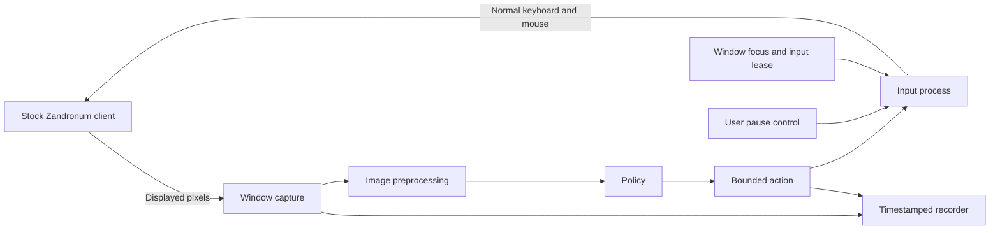

# Architecture and route decision

Use route B for the first playable agent.
The deployment process will observe displayed pixels and send normal keyboard and mouse input.
Add target-game recordings before training a larger policy.
Do not change the engine for Milestone 1.

Use official `3.3-alpha-r260925-2352` as the primary runtime target.
This revision matches the engine used for normal play.
Keep 3.2.1 as a separate compatibility baseline.
Do not transfer an acceptance result between engine revisions without a new test.

## Final deployment contract

The client must use the official, unchanged Zandronum executable.
It must load the original MM8BDM, CBM, and Gondola files.
The player must join as a normal Player.
The server must permit automated players.
The server must not need a ViMM8BDM component.

The policy must receive only information available to the player.
Use game images and visible HUD content first.
Do not read process memory, packets, object lists, depth buffers, or hidden variables during deployment.
The user must be able to stop AI input immediately.

## Compare routes A to D

The estimates below describe engineering effort after machine access works.
They exclude model training time and combat-quality guarantees.
They assume one developer and the supplied target assets.
These estimates are planning judgments.

| Factor | A: use an existing Doom project | B: add an external adapter | C: target-game training wrapper | D: change a training engine |
| --- | --- | --- | --- | --- |
| Initial effort | Approximately 1–3 days if inputs match | Approximately 3–7 days for a local control test | Approximately 2–4 weeks for data, reset, and reward functions | Several weeks or months |
| Model transfer | No audited model has the full required actions | Connects existing actions. Does not establish target-game skill. | Trains on the actual visuals and actions | Trains on the exact mechanisms if the fork remains accurate |
| Training speed | Fast inside ViZDoom, if compatible | Usually limited to real-time play | Real time with stock clients. Parallel sessions need measurement. | Potentially faster stepping and parallel control |
| Compatibility | Doom success does not establish MM8BDM compatibility | Uses the actual client and MOD stack | Stock-client training preserves mechanisms | Engine changes can introduce differences |
| Maintenance | Low until old dependencies or missing inputs require changes | Small OS-specific capture and input layer | Dataset and scenario maintenance | Continuous source and protocol maintenance |
| Final deployment | No audited project supplies it directly | Meets the intended external-control design | Uses the same external adapter | Training only. Still requires route B for deployment. |

Route A did not satisfy the audit.
ContinuousDoom supplies a usable inference experiment, but it lacks several required actions.
Route B is the smallest useful next step.
Route C should first mean a small recorder and Gymnasium-compatible wrapper.
It does not require a new engine or general Zandronum API.
Route D remains a conditional training option.

## Minimal process flow

Keep these functions in one Python application during M1.
Use a separate input process before deployment.
That process must release its inputs when the policy heartbeat expires.
It must also accept the user's pause command without waiting for inference.

## Host choice

Use a Windows process for capture and input on the primary runtime.
Use a Linux process if the client runs on Linux.
WSL remains suitable for research and training.
Do not assume that WSL screenshot packages can capture Windows application surfaces.

The local experiment ran a stock Linux client under WSLg.
MSS captured a black desktop root.
Direct X11 window capture returned the rendered game image.
The prototype therefore offers an `x11-window` backend.
That backend supports the tested 24-bit TrueColor format only.

The Windows code checks the foreground HWND and window identity.
Keyboard and button events use pynput.
Relative mouse movement uses normal Win32 `SendInput` events.
The capture backend follows the client area and omits other foreground applications.
The Windows alpha input test passed the operator's visual check without camera flicker.
Mouse calibration and performance under network delay still require tests.
Do not use engine hooks as a fallback.

The optional local-server test uses a stock server bound to the loopback address.
The ordinary stock client joins that server as a Player.
This avoids the automatic bots in the single-player campaign.
It does not install an additional server component or inspect network packets.

## Observation contract

Each observation contains an image, image dimensions, and a monotonic capture timestamp.
Use the time before capture starts.
This timestamp includes capture delay in the image-age check.
Record the client area, render settings, FOV, HUD scale, and model preprocessing.
Reject stale images before input execution.

The final policy should initially use RGB images and a short image history.
Use a small CNN or an existing licensed encoder.
Add a recurrent state only after a measurable task requires it.
Keep visible HUD readings as optional image-derived features.
Do not fill missing engine variables with arbitrary zero values and claim equivalent inference.

ContinuousDoom requires four grayscale images at 320 by 240 pixels.
Its original training interval is four game ticks.
The adapter normalizes pixels to the range zero through one.
Pillow grayscale and resize operations approximate the original image path.
Pixel-level equivalence with the engine's grayscale conversion remains untested.

## Action contract

The first interface supports held movement keys, mouse X/Y deltas, and primary attack.
The final learned action should add the following fields:

| Field | Meaning |
| --- | --- |
| Movement buttons | Independent forward, backward, left, right, jump, and crouch states |
| Aim deltas | Horizontal and vertical mouse movement over one control interval |
| Combat buttons | Primary attack, alternate attack, reload, and class-specific extra buttons |
| Weapon event | Slot selection or next/previous weapon, with explicit press and release |
| Profile identifier | Character and bindings that the user selected |
| Duration | Intended action interval and maximum permitted hold time |

Do not identify characters through hidden engine state.
Start with a user-selected profile.
Later infer the profile from visible game content if useful.

The supplied CBM KEYCONF defines turbo attack through `+user1` and `+altattack`.
The supplied Gondola KEYCONF also exposes `+reload`.
The audit read these bindings from the supplied packages without changes.
M1 does not yet implement these skill bindings.

ContinuousDoom produces one categorical action and one yaw value.
The adapter preserves those outputs.
It cannot add simultaneous attack and movement, pitch, or class skills without another policy component or training.
Measure mouse counts against visible camera displacement before selecting a permanent conversion.
Do not treat an engine DELTA value as an OS mouse count.

## Control protection

The prototype starts paused.
F8 enables or pauses input.
F9 stops the process.
Esc pauses AI input and remains available to the game menu.
Focus loss, stale observations, and lease expiry disarm the controller.
The user must explicitly enable it again.
The process releases only the keys and mouse buttons it owns.

The current watchdog runs in a Python thread.
Offline tests cover its state logic.
They do not prove recovery after an interpreter failure or forced process termination.
The production input process must use an independent heartbeat.
It must also distinguish human input from injected input before automatic mouse-based takeover becomes available.

## Training decision gates

First record human play on the target stack.
Train behavior cloning before RL.
Test a small set of maps and characters before broad coverage.
Split training and evaluation by complete session, map, and character.
Do not split adjacent frames randomly across those sets.

Use a stock-client training wrapper when real-time collection supplies enough data.
Estimate its throughput from actual rollout durations.
The local client reported llvmpipe rendering, so an accessible GPU does not establish GPU rendering speed.

Test ViZDoom separately before using it for target-game training.
Successful PK3 loading alone does not establish compatible ACS, multiplayer, movement, or damage mechanisms.
Compare movement, jump trajectories, projectile timing, hit registration, and skill behavior with the stock client.
The audit did not establish those comparisons.

Consider a training-engine change only if measured reset or rollout limits prevent the required experiments.
First test simpler resets, parallel stock sessions, and compatible ViZDoom scenarios.
If route D becomes necessary, limit changes to training control and data collection.
Keep the final adapter independent from that engine.
Never use a training-only observation in the deployment policy.
